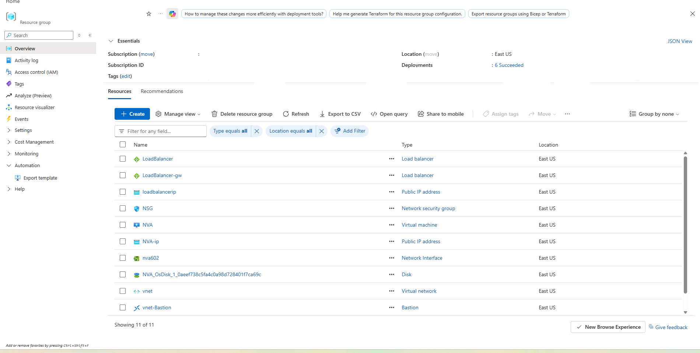
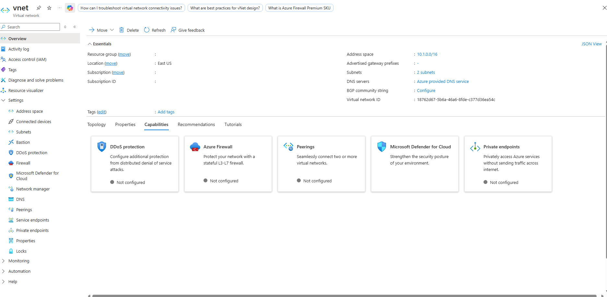
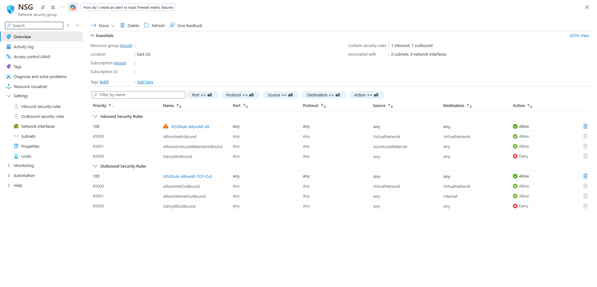
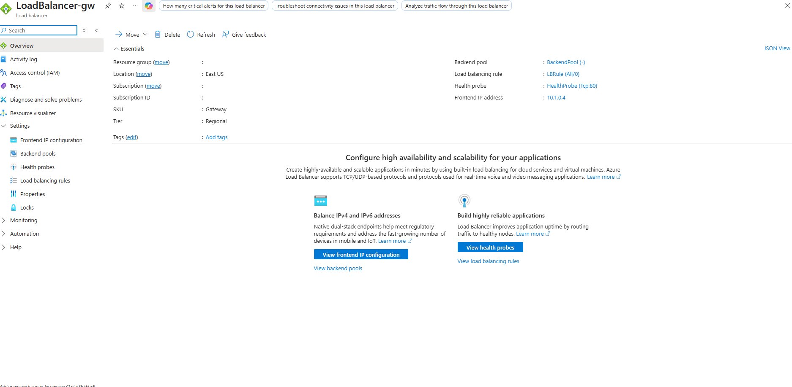
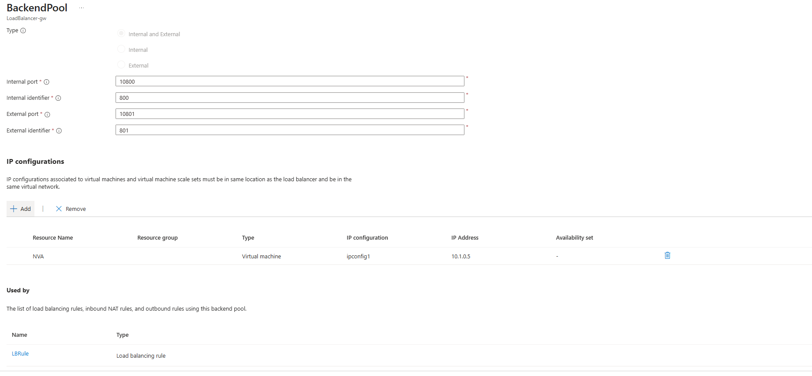
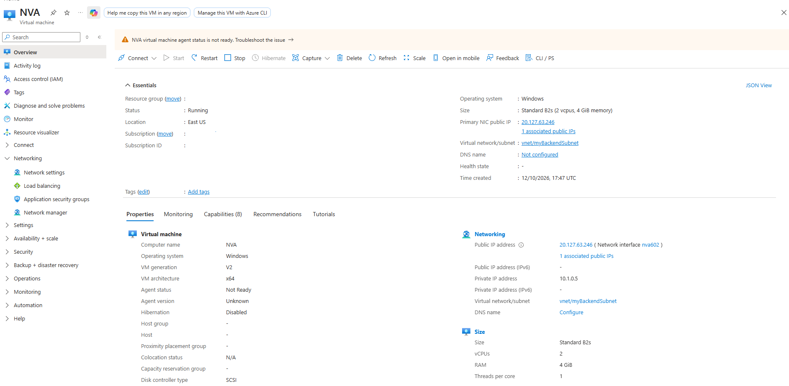
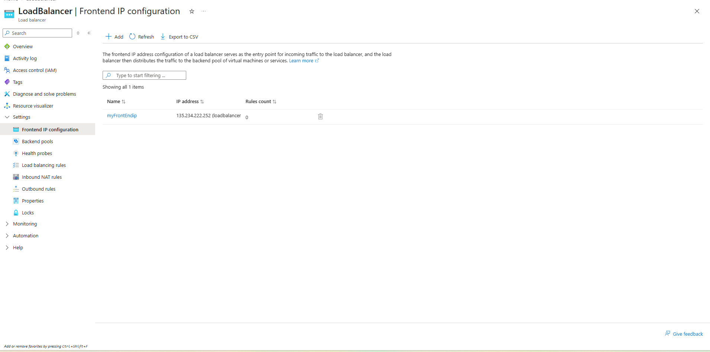
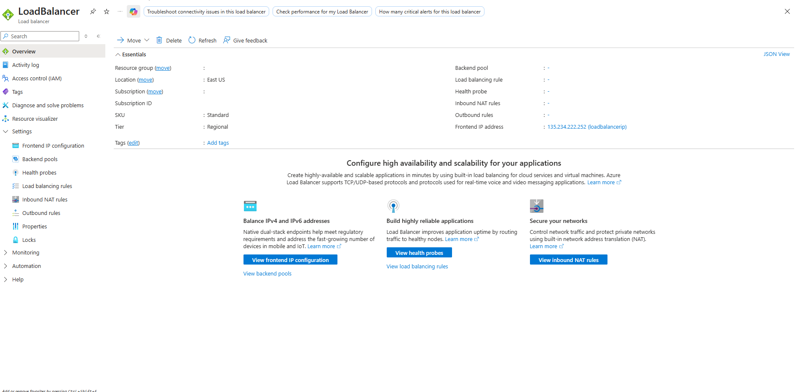
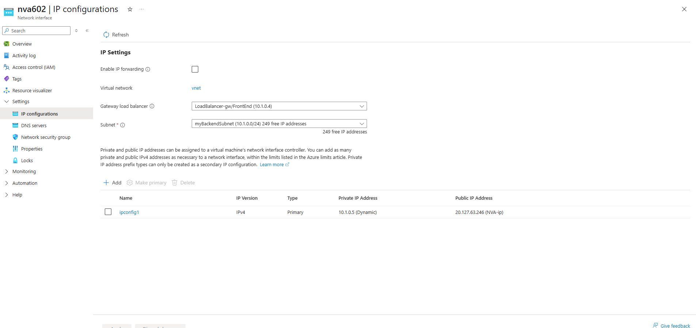

# Deploying and Configuring an Azure Gateway Load Balancer for Network Virtual Appliances

Comprehensive detailing the deployment of an Azure Gateway Load Balancer (`LoadBalancer-gw`) in the East US region configured with VXLAN tunnel interfaces, frontend IP configurations, and backend Network Virtual Appliance (NVA) integration. The architecture enables transparent traffic redirection through security appliances for advanced network inspection.

---

## 1. Architecture & Provisioned Resources

### Core Infrastructure Topology

| Resource Type | Resource Name | Specification / Tier | Region / Location |
| :--- | :--- | :--- | :--- |
| **Gateway Load Balancer** | `LoadBalancer-gw` | Gateway SKU, Regional | East US |
| **Standard Load Balancer** | `LoadBalancer` | Standard SKU, Regional | East US |
| **Frontend Public IP** | `loadbalancerip` | Static Standard IPv4 (`135.234.222.252`) | East US |
| **Virtual Network** | `vnet` | Address Space: `10.1.0.0/16` | East US |
| **Backend Subnet** | `myBackendSubnet` | Address Prefix: `10.1.0.0/24` | East US |
| **Bastion Subnet** | `AzureBastionSubnet` | Address Prefix: `10.1.1.0/26` | East US |
| **Network Virtual Appliance** | `NVA` | Standard B2s, Windows Server 2019 Datacenter | East US |
| **Network Security Group** | `NSG` | Allow-all inbound/outbound security rules | East US |

---

### Provisioned Environment Validation

*Resource group overview confirming the successful provisioning of the Gateway Load Balancer, Standard Load Balancer, virtual network, Bastion host, and NVA compute instance.*

---

## 2. Step-by-Step Implementation

### Step 1: Inspect Virtual Network Configuration

Reviewed the core virtual network (`vnet`) layout and backend subnet configurations designed to host the Network Virtual Appliance and load balancer infrastructure.

* **Virtual Network:** `vnet`
* **Address Space:** `10.1.0.0/16`
* **Subnets Configured:** `myBackendSubnet` (`10.1.0.0/24`) and `AzureBastionSubnet` (`10.1.1.0/24`)

*Reviewing essentials and parameters for virtual network vnet.*

---

### Step 2: Configure Network Security Group Rules

Inspected the network security group (`NSG`) protecting the backend subnets and NVA instances, verifying custom allow rules for traffic flow.

* **NSG Name:** `NSG`
* **Inbound Rules:** `NSGRule-AllowAll-All` (Priority 100, Allow All)
* **Outbound Rules:** `NSGRule-AllowAll-TCP-Out` (Priority 100, Allow All)

*Inspecting inbound and outbound security rules configured on the NSG.*

---

### Step 3: Deploy and Configure Gateway Load Balancer

Inspected the deployed Gateway Load Balancer (`LoadBalancer-gw`) configuration, verifying its Gateway SKU, backend pool tunnel interfaces, and health probe settings.

* **Load Balancer Name:** `LoadBalancer-gw`
* **SKU / Tier:** Gateway SKU / Regional
* **Frontend IP Configuration:** `FrontEnd` (`10.1.0.4`)
* **Backend Pool:** `BackendPool` configured with VXLAN tunnel interfaces (Internal Port: 10800, External Port: 10801)
* **Health Probe:** `HealthProbe` (TCP Port 80)

*Reviewing Gateway Load Balancer essentials, backend pool tunnel mappings, and health probes.*

---

### Step 4: Configure Backend Pool and NVA Association

Managed the backend pool associations to integrate the Network Virtual Appliance (`NVA`) instance into the Gateway Load Balancer's data path.

* **Target Appliance:** `NVA`
* **IP Configuration:** `ipconfig1` (`10.1.0.5`)
* **Tunnel Association:** Mapped to Gateway Load Balancer frontend mapping.

*Configuring backend pool parameters, VXLAN encapsulation ports, and NVA IP configuration mapping.*

---

### Step 5: Verify Network Virtual Appliance Properties

Inspected the compute and networking properties for the NVA instance to confirm runtime allocation, primary network interface bindings, and public IP assignment.

* **Virtual Machine Name:** `NVA`
* **Private IP Address:** `10.1.0.5`
* **Public IP Address:** `20.127.63.246` (`NVA-ip`)

*Inspecting compute sizing, operating system, and networking properties for NVA.*

---

### Step 6: Verify Frontend IP and Gateway Association

Inspected the frontend IP configuration linking the Standard Load Balancer to the Gateway Load Balancer service chain.

* **Frontend Configuration Name:** `myFrontEndip`
* **Public IP Address:** `135.234.222.252` (`loadbalancerip`)
* **Gateway Load Balancer Association:** Linked to `LoadBalancer-gw/FrontEnd`

*Confirming public frontend IP allocation and chaining to the Gateway Load Balancer.*

---

### Step 7: Validate Standard Load Balancer Overview

Inspected the companion Standard Load Balancer configuration to confirm regional tier settings and frontend IP bindings.

* **Load Balancer Name:** `LoadBalancer`
* **SKU / Tier:** Standard / Regional
* **Frontend IP Configuration:** `loadbalancerip` (`135.234.222.252`)

*Reviewing Standard Load Balancer overview and public frontend IP configuration.*

---

### Step 8: Validate NIC Gateway Load Balancer Bindings

Verified that the network interface (`nva602`) of the Network Virtual Appliance correctly references the Gateway Load Balancer configuration.

* **Network Interface:** `nva602`
* **Associated Gateway Load Balancer:** `LoadBalancer-gw/FrontEnd (10.1.0.4)`
* **Subnet Binding:** `myBackendSubnet`

*Inspecting NIC IP settings confirming active binding to the Gateway Load Balancer.*
